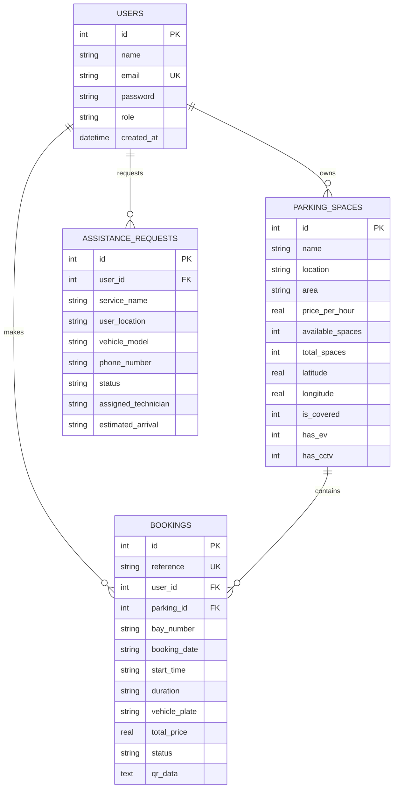

# ParkEase 🚗🅿️
> **Smart Urban Parking Discovery & On-Demand Roadside Assistance Platform**

ParkEase is a modern, responsive full-stack platform designed to eliminate parking congestion and provide emergency roadside mobility support in congested metropolitan areas. Built with a clean **React 19 + Tailwind CSS** frontend, a high-performance **Node.js Express** backend, and an integrated **SQLite** database.

---

## 🌟 Key Highlights

- **🗺️ Live Interactive Map**: Powered by Leaflet & OpenStreetMap (zero paid API keys required). Features clickable pins, availability counters, EV charging indicators, and dynamic popups.
- **⚡ Three Search Views**: Toggle seamlessly between **Split View** (cards + sticky map), **Map Only**, and **Grid Only**.
- **🎫 Digital QR Entry Passes**: Instant reservation system that auto-allocates parking stalls (`Bay P-04`) and generates cryptographically verified QR passes for barrier gates.
- **💳 Multi-Method Indian Payment Sandbox**: Supports **UPI (GPay / PhonePe / Paytm)**, **Credit / Debit Cards**, **Net Banking**, and **Pay on Arrival** with pricing calibrated in **Indian Rupees (₹)**.
- **🛠️ Emergency Roadside Assistance**: 1-click dispatch for mobile mechanics, puncture repairs, battery jump-starts, and towing units with real-time technician ETA tracking.
- **🅿️ Host Monetization Portal**: Private space owners can list their unused driveways or commercial garages with an integrated monthly income calculator.
- **📋 My Bookings Dashboard**: Dedicated driver portal (`/my-bookings`) to manage active reservations, view saved QR codes, and cancel bookings anytime.

---

## 🛠️ Technology Stack

| Layer | Technologies |
| :--- | :--- |
| **Frontend** | React 19, Vite 8, Tailwind CSS v4, Lucide React, React Router 7, Leaflet |
| **Backend** | Node.js, Express 5, CORS, Dotenv, JSON Web Tokens (JWT), Bcrypt.js, QRCode |
| **Database** | SQLite3 (`server/data/parkease.db`), `sqlite` async wrapper |
| **Tooling & Linter** | Oxlint (0 errors, 0 warnings), Concurrently, Multi-stage Docker |

---

## 🔑 Pre-Configured Demo Accounts

You can test user flows immediately using these built-in test accounts:

| Role | Email | Password | Access Capabilities |
| :--- | :--- | :--- | :--- |
| **Motorist / Driver** | `alex.rivera@example.com` | `password123` | Reserve spaces, view QR passes, request roadside SOS |
| **Parking Space Host** | `host@parkease.com` | `password123` | List private driveways, view host earnings projections |

*(You can also register a new verified account via the built-in Auth Modal or `/login` page).*

---

## 🚀 Getting Started

### Prerequisites
- [Node.js](https://nodejs.org/) (v18 or higher recommended)
- Git

### 1. Clone & Install
```bash
git clone https://github.com/your-username/parkease.git
cd parkease
npm install
```

### 2. Run in Development Mode (Frontend + Backend)
To run both the Express API (`:5000`) and the Vite client (`:5173`) concurrently:
```bash
npm run dev:all
```
- Open client: **`http://localhost:5173`**
- API health check: **`http://localhost:5000/api/health`**

### 3. Run Production Build (Single Port Full-Stack)
```bash
npm run build
npm start
```
The Express server will automatically serve the built client bundle from `/dist` directly on **`http://localhost:5000`**.

### 4. Windows 1-Click Launcher
Double-click `run-parkease.bat` in the root folder to build and launch automatically.

---

## 📡 REST API Reference

All backend endpoints are prefixed with `/api`:

| Method | Endpoint | Description | Auth Required |
| :---: | :--- | :--- | :---: |
| `GET` | `/api/health` | Service health status and database engine | No |
| `GET` | `/api/parking` | Search & filter facilities (location, type, sort) | No |
| `GET` | `/api/parking/:id` | Get facility details by ID | No |
| `POST` | `/api/parking` | Host onboarding form to list a new space | Optional |
| `POST` | `/api/bookings` | Create reservation, allocate bay & generate QR pass | Optional |
| `GET` | `/api/bookings/my-bookings` | Retrieve user reservation history | Yes (Bearer Token) |
| `PUT` | `/api/bookings/:id/cancel` | Cancel an active booking and release bay | Optional |
| `POST` | `/api/assistance` | Dispatch emergency roadside service unit | Optional |
| `GET` | `/api/promotions` | List verified automotive sponsor offers | No |
| `POST` | `/api/auth/register` | Register new motorist or parking host account | No |
| `POST` | `/api/auth/login` | Login and obtain signed JWT token | No |
| `GET` | `/api/auth/me` | Fetch authenticated user profile | Yes (Bearer Token) |

---

## 🗄️ Database Schema (`parkease.db`)



---

## 🐳 Docker Deployment

To build and run ParkEase in an isolated Docker container:

```bash
docker build -t parkease-app .
docker run -p 5000:5000 --name parkease parkease-app
```

Then visit **`http://localhost:5000`** in your browser.

---

## 📄 License
MIT License. Built for smart city mobility innovation.
